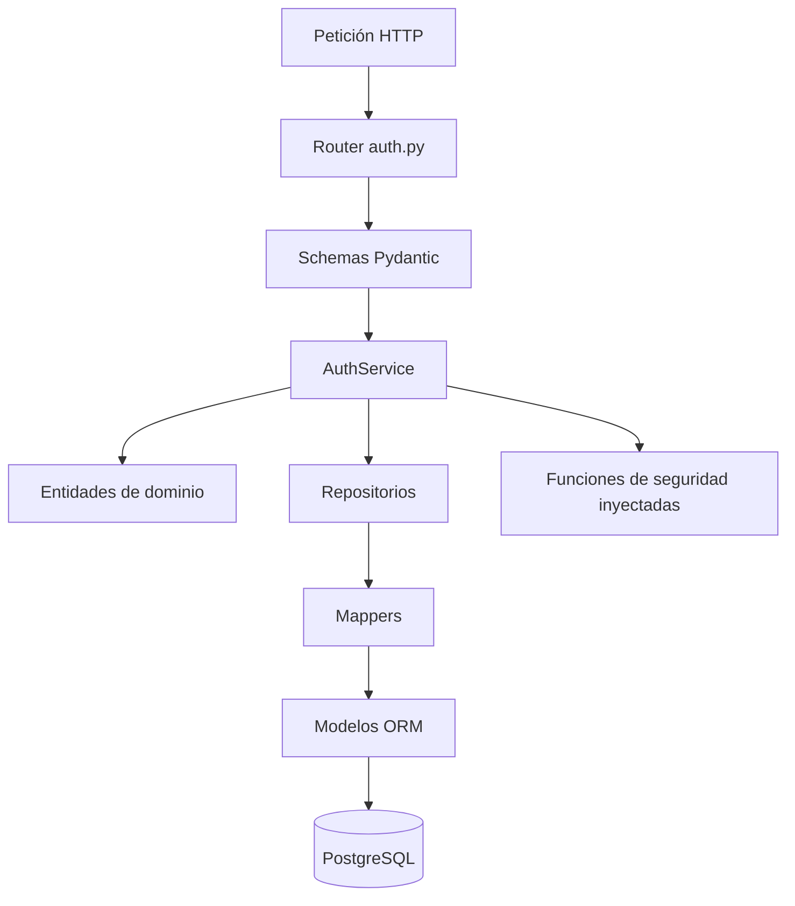
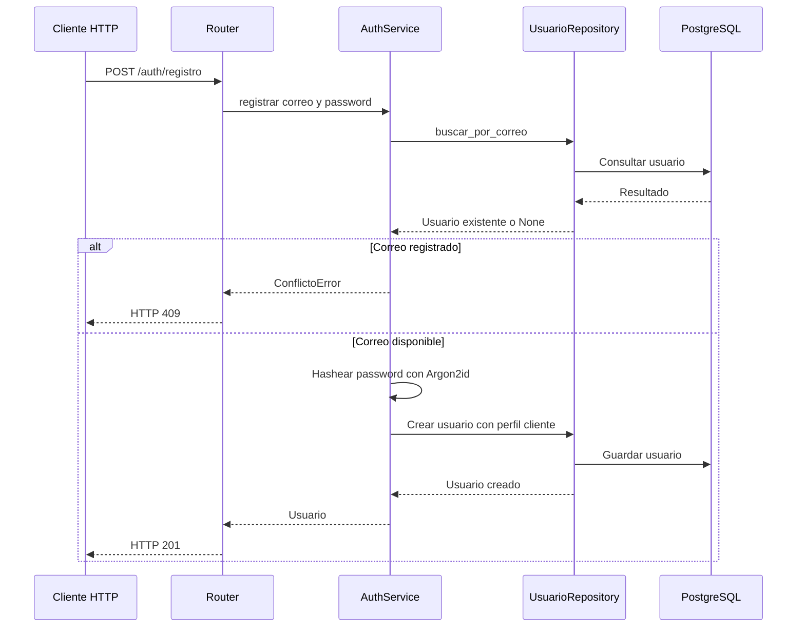
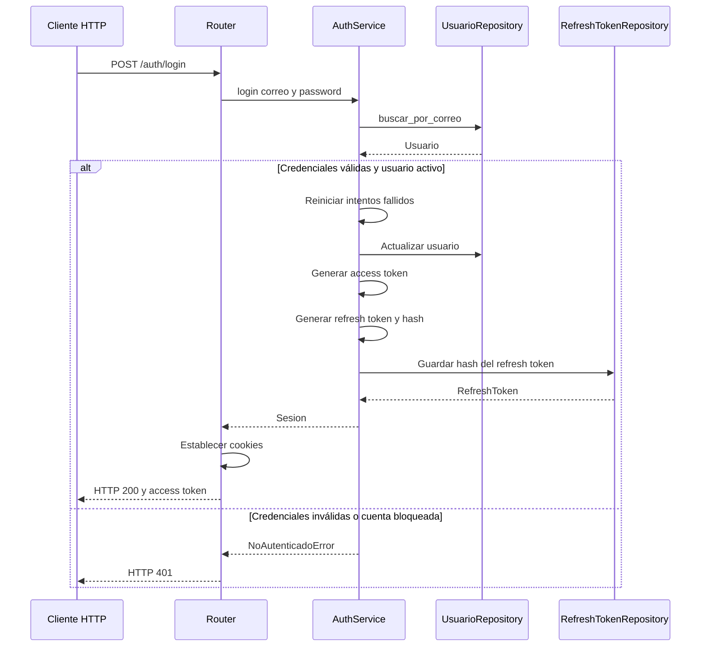
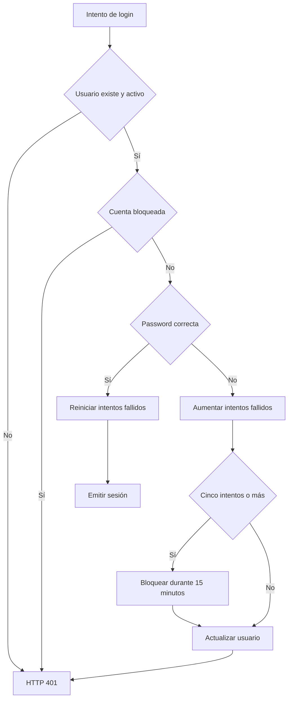
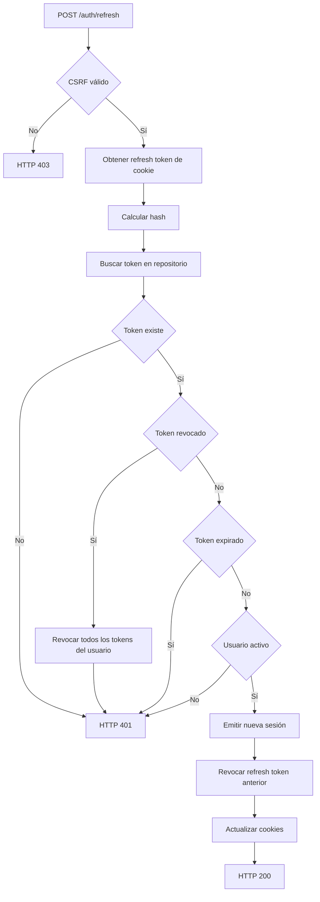
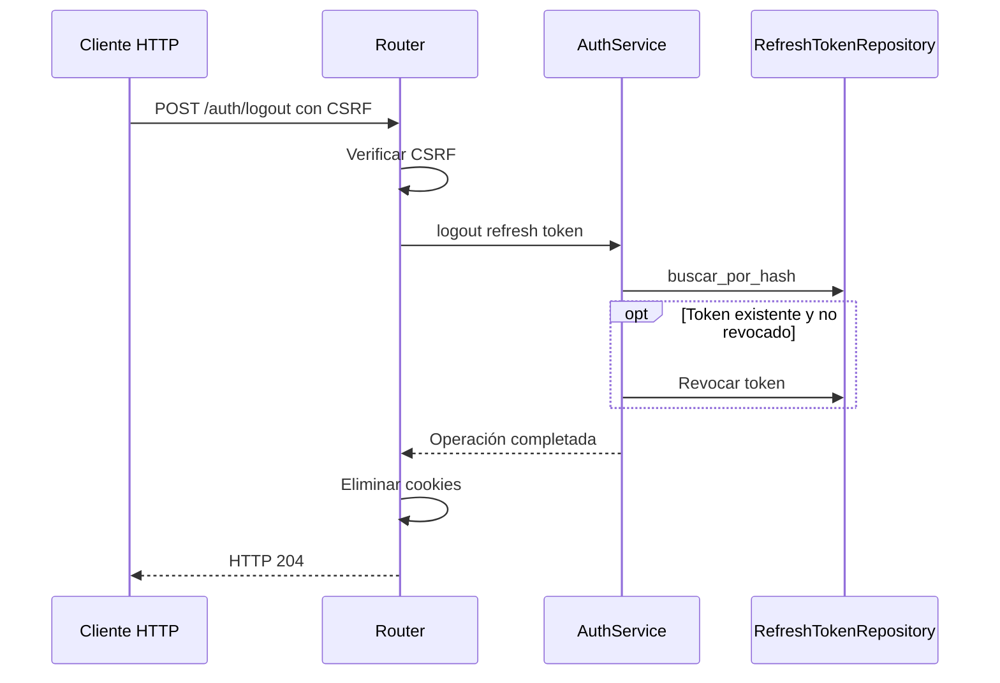

# Diagramas de autenticación — Javier

## 1. Responsabilidad

Implementación de la autenticación de usuarios, administración de
sesiones y protección de los endpoints de estaciones y reservas.

## 2. Arquitectura

El router recibe las peticiones HTTP y delega las operaciones
al servicio de autenticación.

AuthService contiene las reglas de negocio y recibe los
repositorios y funciones criptográficas mediante inyección
de dependencias.

Los repositorios gestionan la persistencia de las entidades
de dominio utilizando los mappers y modelos ORM.

## 3. Registro de usuario

La contraseña nunca se almacena en texto plano.
El usuario registrado recibe el perfil cliente.

## 4. Inicio de sesión

El access token tiene una duración de 15 minutos.
El refresh token tiene una duración de 7 días.

El refresh token se almacena en una cookie HttpOnly.
En PostgreSQL se almacena únicamente su hash SHA-256.

## 5. Bloqueo de cuenta

Los errores de credenciales utilizan un mensaje genérico
para no revelar si el correo existe.

## 6. Renovación de sesión

Cada renovación genera un nuevo refresh token.

Si se intenta reutilizar un token revocado, se revocan
todos los refresh tokens asociados al usuario.

## 7. Cierre de sesión

El cierre de sesión revoca el refresh token y elimina
las cookies de autenticación.

El access token previamente emitido puede continuar
siendo válido hasta su expiración, ya que no existe
una lista de revocación de access tokens.

## 8. Protección de endpoints

| Endpoint | Autenticación | Perfil |
| --- | --- | --- |
| POST /auth/registro | No | Público |
| POST /auth/login | No | Público |
| POST /auth/refresh | Refresh y CSRF | Usuario activo |
| POST /auth/logout | CSRF | Según sesión |
| GET /auth/me | Bearer JWT | Cualquiera |
| GET /estaciones | No | Público |
| GET /estaciones/{id} | No | Público |
| POST /estaciones | Bearer JWT | Cualquiera |
| PATCH /estaciones/{id} | Bearer JWT | Encargado |
| GET /reservas | Bearer JWT | Cualquiera |
| GET /reservas/{id} | Bearer JWT | Cualquiera |
| POST /reservas | Bearer JWT | Cualquiera |
| PATCH /reservas/{id} | Bearer JWT | Cualquiera |
| DELETE /reservas/{id} | Bearer JWT | Cualquiera |

## 9. Pruebas

### Unitarias

Archivo: tests/unit/test_auth_service.py

- Inicio de sesión correcto.
- Mensaje genérico para credenciales inválidas.
- Bloqueo después de cinco intentos fallidos.
- Revocación de sesiones por reutilización de refresh token.

### End-to-end

Archivo: tests/e2e/test_acceso_negocio.py

- Rechazo de peticiones sin autenticación.
- Registro de usuario.
- Inicio de sesión.
- Consulta del usuario autenticado.
- Creación y consulta de una reserva.
- Eliminación de la reserva de prueba.
- Cierre de sesión.
- Rechazo de refresh token revocado.

Las pruebas E2E utilizan httpx contra una instancia real
de la API conectada a PostgreSQL.

## 10. Archivos asociados

- app/domain/excepciones.py
- app/application/services/auth_service.py
- app/application/services/estacion_service.py
- app/application/services/reserva_service.py
- app/presentation/routers/auth.py
- app/presentation/routers/estaciones.py
- app/presentation/routers/reservas.py
- tests/unit/test_auth_service.py
- tests/e2e/test_acceso_negocio.py
- docs/diagramas/auth_javier.md