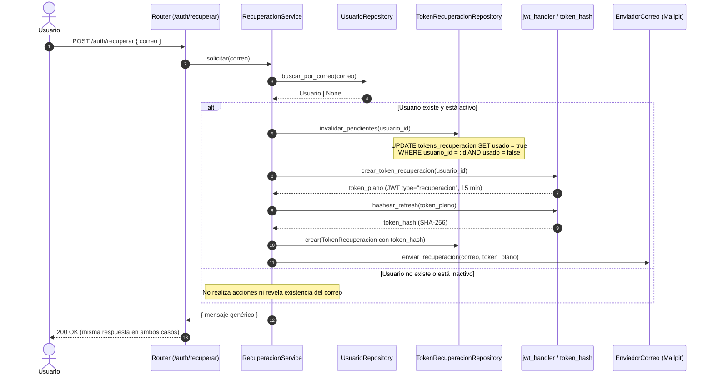

# Flujo de Recuperación de Contraseña e Invalidación de Sesiones

Este documento detalla el ciclo completo de recuperación de contraseña (`POST /auth/recuperar` y `POST /auth/restablecer`), destacando el almacenamiento exclusivo del hash del token, el consumo atómico de un solo uso y el punto exacto donde se invalidan todas las sesiones activas (`refresh_tokens`).

## 1. Solicitud de Recuperación (`POST /auth/recuperar`)

---

## 2. Restablecimiento de Contraseña e Invalidación de Sesiones (`POST /auth/restablecer`)

```mermaid
sequenceDiagram
    autonumber
    actor U as Usuario
    participant R as Router (/auth/restablecer)
    participant S as RecuperacionService
    participant JWT as jwt_handler / token_hash
    participant TR as TokenRecuperacionRepository
    participant PASS as password (Argon2id)
    participant UR as UsuarioRepository
    participant RR as RefreshTokenRepository

    U->>R: POST /auth/restablecer { token, nueva_password }
    R->>S: restablecer(token, nueva_password)
    S->>JWT: decodificar_token_recuperacion(token)
    JWT-->>S: payload { sub: usuario_id, type: "recuperacion" }

    S->>JWT: hashear_refresh(token)
    JWT-->>S: token_hash

    rect rgb(40, 44, 52)
        Note over S,TR: Consumo atómico (evita race conditions / doble uso)
        S->>TR: marcar_usado(token_hash)
        TR->>TR: UPDATE tokens_recuperacion SET usado = true<br/>WHERE token_hash = :h AND usado = false AND expira_en > now()
        TR-->>S: True (rowcount == 1) | False
    end

    alt marcar_usado devuelve False (usado o expirado)
        S-->>R: ReglaNegocioError (400 genérico)
        R-->>U: 400 Bad Request
    else marcar_usado devuelve True
        S->>PASS: hashear_password(nueva_password)
        PASS-->>S: nuevo_password_hash
        S->>UR: actualizar(usuario: nueva clave, intentos_fallidos=0, bloqueado_hasta=None)
        rect rgb(65, 35, 35)
            Note over S,RR: INVALIDACIÓN GLOBAL DE SESIONES PREVIAS
            S->>RR: revocar_todos(usuario_id)
            RR->>RR: UPDATE refresh_tokens SET revocado = true WHERE usuario_id = :id
        end
        S-->>R: { mensaje: "Contraseña actualizada correctamente." }
        R-->>U: 200 OK
    end
```

