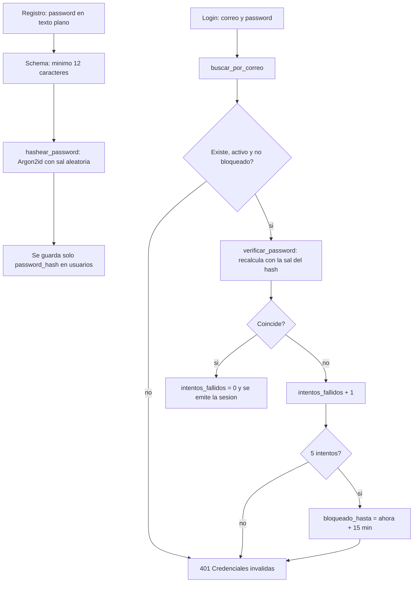
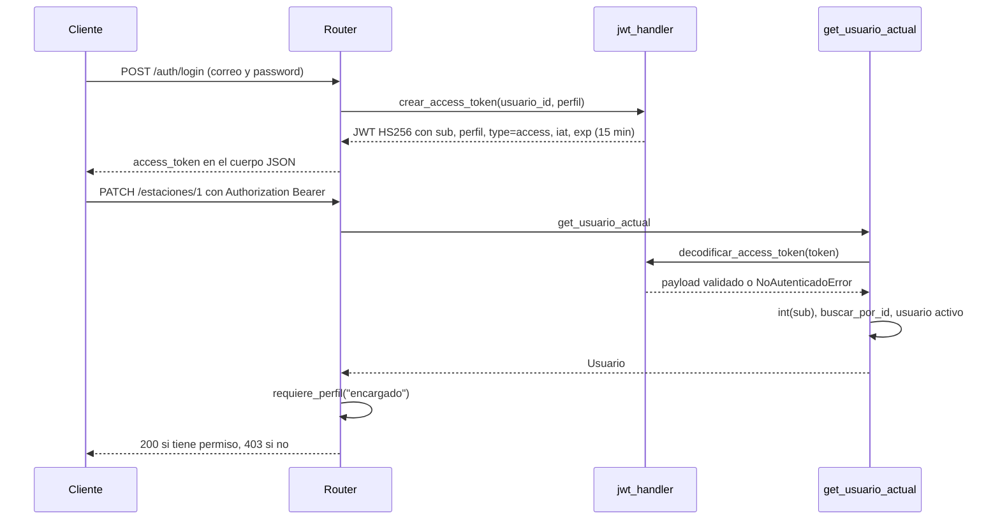
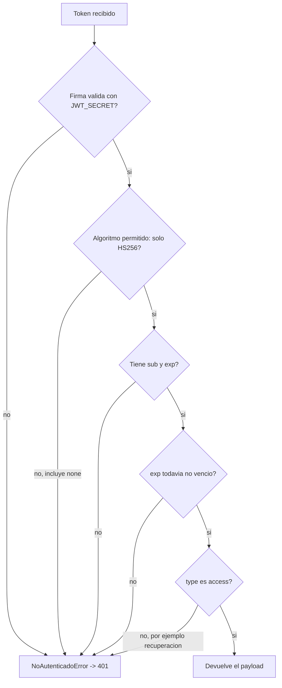
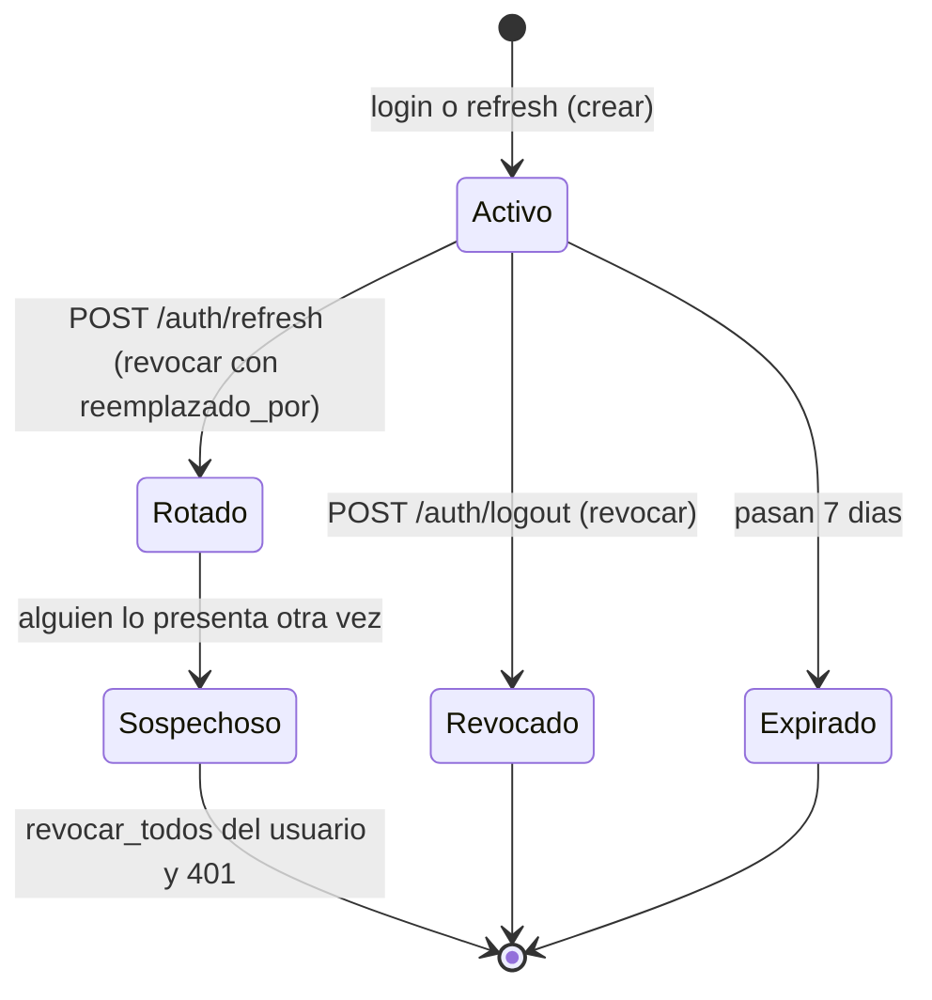
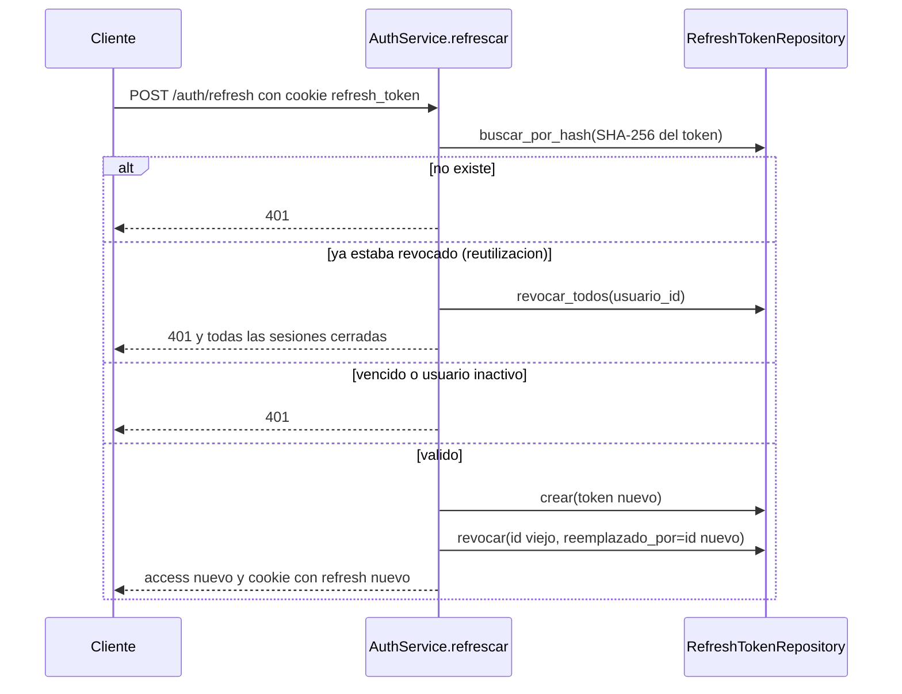
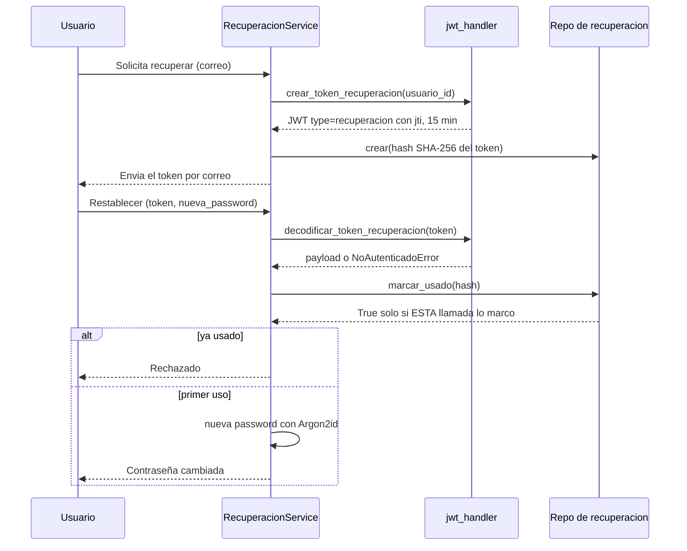

# Seguridad: contraseñas, access JWT, refresh token y token de recuperación

Documento de Kevin (Grupo 04, Centro Gamer). Describe lo implementado en
`app/infrastructure/security/` (`password.py`, `jwt_handler.py`, `token_hash.py`),
`app/domain/usuario.py`, `refresh_token_model.py` y `refresh_token_repo.py`, y cómo
lo usan `AuthService` (Javier) y `RecuperacionService` (Joako).

## 1. Los tres tokens en una tabla

| | Access token | Refresh token | Token de recuperación |
|---|---|---|---|
| Qué es | JWT firmado (HS256) | Cadena aleatoria opaca | JWT firmado (HS256) |
| `type` | `access` | no aplica (no es JWT) | `recuperacion` |
| Duración | 15 minutos | 7 días | 15 minutos |
| Claims | `sub`, `perfil`, `type`, `iat`, `exp` | ninguno | `sub`, `jti`, `type`, `iat`, `exp` |
| Dónde viaja | Cabecera `Authorization: Bearer` | Cookie HttpOnly `refresh_token` | Correo (enlace o token) |
| Qué se guarda en la BD | Nada (el servidor no guarda estado) | Solo su hash SHA-256 | Solo su hash SHA-256 (tabla de Joako) |
| Para qué sirve | Acceder a la API | Pedir un access nuevo | Restablecer la contraseña una sola vez |

## 2. Contraseñas (Argon2id)

- Argon2id es lento y consume memoria a propósito: probar millones de claves contra una
  base filtrada resulta carísimo.
- El hash incluye su propia sal, así que la misma contraseña produce hashes distintos.
- `verificar_password` devuelve `False` (nunca lanza ni revela detalles) si no coincide
  o si el hash guardado no es válido.
- Todos los fallos de login devuelven el mismo mensaje, para no revelar si el correo existe.

## 3. Access JWT: emisión y validación

Qué valida `decodificar_access_token`, en orden:

| Validación | Ataque que evita |
|---|---|
| Firma con `JWT_SECRET` | Editar el payload (por ejemplo pasar de `cliente` a `encargado`) |
| Algoritmo fijado (`algorithms=["HS256"]`) | Tokens con `alg: none` o con otro algoritmo declarado por el atacante |
| `sub` y `exp` obligatorios | Tokens sin caducidad, que vivirían para siempre |
| `exp` vencido | Reutilizar un token robado pasado el límite de 15 minutos |
| `type == "access"` | Usar un token de recuperación (misma clave) como token de acceso, y al revés |
| Mensaje de error genérico | Dar pistas sobre qué parte del ataque funcionó |

El `JWT_SECRET` se lee del entorno al momento de usarse; si falta, es un error de
configuración del servidor (`ValueError`) y no un 401.

## 4. Refresh token: ciclo de vida

- `generar_refresh_token` usa `secrets.token_urlsafe(32)`: 32 bytes aleatorios
  criptográficamente seguros. No contiene información.
- `hashear_refresh` aplica SHA-256 y devuelve 64 caracteres hexadecimales. Solo ese hash
  se guarda en `refresh_tokens.token_hash` (columna única).
- El token en claro solo existe en la cookie `refresh_token` (HttpOnly, `path=/auth`,
  `SameSite=lax`, `Secure` según `COOKIE_SECURE`). Nunca va en el cuerpo JSON.
- SHA-256 alcanza (a diferencia de las contraseñas) porque el token ya es aleatorio y
  largo: no hay nada que adivinar por fuerza bruta.
- `/auth/refresh` y `/auth/logout` exigen además el token CSRF.

## 5. Rotación, revocación y detección de reutilización

- **Rotación:** cada refresh entrega un token nuevo e invalida el anterior, anotando en
  `reemplazado_por` cuál lo reemplazó.
- **Revocación:** `revocar` cierra una sesión (logout) y `revocar_todos` cierra todas las
  sesiones activas de un usuario.
- **Reutilización:** si alguien presenta un token que ya fue rotado, es señal de robo, y
  se cierran todas las sesiones del usuario.
- El repositorio recibe y devuelve entidades de dominio, usa los mappers de
  infraestructura y ante un `IntegrityError` hace rollback y lanza `ConflictoError`.
- Las fechas (`expira_en`, `creado_en`) usan `DateTime(timezone=True)` para poder
  compararse con `datetime.now(timezone.utc)`.

### Limitación conocida y mejora propuesta

Hoy `revocar` actualiza sin condición. Si dos solicitudes presentan **a la vez** el mismo
refresh token válido, ambas pasan la lectura y ambas emiten una sesión nueva: de un solo
token nacen dos sesiones activas. (Se reprodujo en una simulación con dos sesiones de BD.)

Mejora propuesta, pendiente de acordar con Javier: que `revocar` use
`UPDATE ... WHERE revocado = false` y devuelva `True` solo si esta llamada fue la que
revocó. Si devuelve `False`, `AuthService` llamaría a `revocar_todos` y respondería 401.
Al ser atómica en la base, solo una de las solicitudes concurrentes gana.

## 6. Token de recuperación de contraseña

- El `type=recuperacion` impide usarlo como access token, y viceversa.
- El `jti` único hace que cada token tenga un hash distinto.
- El uso único lo garantiza `marcar_usado`, atómico en la base (de Joako).

## 7. Resumen de diferencias

- **Access:** vida corta, sin estado en el servidor, viaja en cada petición.
- **Refresh:** vida larga, con estado (hash en BD), solo sirve para pedir otro access y
  se rota en cada uso.
- **Recuperación:** vida corta, de un solo uso, solo sirve para restablecer la contraseña.